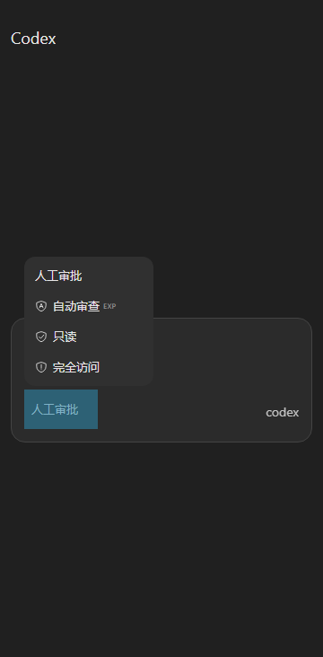
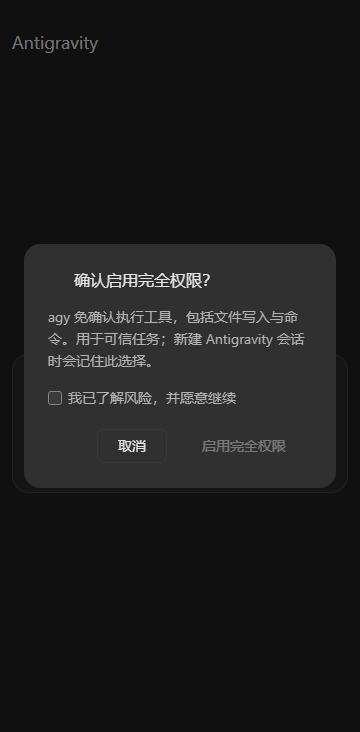

# Agent 原生审批模式

会话输入栏的权限入口按 Agent 展示原生能力，并继续使用 DSH 的 PermissionSelect 和风险确认组件。

| Agent | 模式 | 执行参数 |
| --- | --- | --- |
| Codex | 人工审批、自动审查、只读、完全访问，危险操作需确认、完全访问 | 原有 sandbox/approvalPolicy；自动审查将 thread 和 turn 的 `approvalsReviewer` 设为 `auto_review`，其余模式恢复 `user` |
| ZCode | 人工审批、自主审批、规划、自动接受编辑、完全访问 | `build`、`guarded`、`plan`、`edit`、`yolo` |
| Antigravity | 默认、自动接受编辑、规划、完全访问 | `agy acp` 的 `default`、`accept-edits`、`plan`，以及启动开关 `--dangerously-skip-permissions` |

其他 Agent 保留 DSH 原有权限入口。新建普通 agy 会话从第一轮使用最近一次选定的模式。需要审批的模式在回合开始时将 DSH 的「完全权限」预设切到「工作区内修改」。

## 保存与回合边界

选择会保存到当前会话，并作为该 Agent 新建普通会话时的偏好。完全访问沿用 DSH 的勾选确认流程，确认文案说明记忆行为；自动审查也保留原生风险确认。Team/子会话不借用普通会话的全局权限偏好。

运行中或已有排队消息时仍可更改权限，但新设置只对下一轮生效。当前 Provider 回合、工具续段和同轮其他 Agent 输入使用启动时的权限快照；未知权限也必须保持未知。延迟返回的 Provider 身份绑定不会覆盖运行中刚保存的设置。保存失败时恢复之前的显示值。

旧 Codex/ZCode 会话没有显式原生模式，或保存了旧 `inherit` 值时，继续保留原有 DSH 权限。Antigravity 未选模式或保存了已移除的模式时使用 `default`。

## Codex 完全访问并保留危险操作确认

Codex 新增「完全访问，危险操作需确认」，持久化值为 `full-access-confirm`。启用前复用 DSH 的风险确认组件，必须勾选确认后才能保存；取消、关闭、切换会话或保存失败均保留原选项。这个模式只对 Codex 开放，其他 Agent 和子会话不会借用普通 Codex 会话的偏好。

| 模式 | Codex 文件沙箱 | 审批策略 | 审批处理者 |
| --- | --- | --- | --- |
| 人工审批 | `workspace-write` | `on-request` | `user` |
| 完全访问，危险操作需确认 | `danger-full-access` | `on-request` | `user` |
| 完全访问 | `danger-full-access` | `never` | `user` |

新模式不会逐项确认所有文件修改或命令，只有 Codex 要求审批的操作才进入 DSH 的审批流程。Codex 的危险命令识别和禁止规则仍生效，审批不保证操作一定被允许。

新用户回合开始时，Registry 按该回合的权限快照，通过 DSH `approval.setPolicy(agent, 'ask')` 确保审批入口可用；已经是 `ask` 时不重复写入。这样从原「完全访问」切换后，DSH 遗留的 `never` 不会再次自动拒绝请求。保存选项、分段续跑和同轮插话不会提前更改 DSH 的审批策略。缺少服务、策略未知或设置后未生效时，回合在启动 Codex 前报错停止。原「完全访问」仍使用 `never`，其危险命令可能在进程启动前被直接拒绝。

Windows 真实 Stage0 已验证批准、拒绝、取消、实际设置持久化和重启后恢复同一 Codex 会话，详见 [2026-11-21 Stage0 验收记录](../specs/spec007.1-外部Agent适配器扩展/docs/20261121-Codex完全访问危险操作确认Stage0验收.md)。验收部署的插件设置应放在可写 Profile 中；放到命令行覆盖层会让 DSH 拒绝保存会话索引。

## CLI 条件

Codex 自动审查要求 app-server 支持 `approvalsReviewer: auto_review`；本次从安装的 Codex 0.162.0 导出协议 schema，确认 thread/turn 参数支持该字段。ZCode 自主审批要求运行时支持 `guarded`。不支持这些原生能力的 CLI 应先升级或选用其支持的模式。

本机 agy 1.5.12 的 `session/new` 返回 `currentModeId: default`，以及 `default`、`accept-edits`、`plan` 三个可选模式。

## 验证与复现

使用 Node >=24.9，在完成项目安装和构建后运行：

```sh
node --import ./tests/register-css-loader.mjs --test --test-concurrency=1 \
  tests/native-approval-modes.spec.ts \
  tests/native-approval-next-turn.spec.ts \
  tests/native-approval-ui.spec.ts \
  tests/native-approval-zcode.spec.ts \
  tests/cli-adapters-codex-permissions.spec.ts \
  tests/cli-adapters-antigravity-permissions.spec.ts \
  tests/cli-adapters-zcode-interactions.spec.ts
```

浏览器用例需要已安装的 Chromium，以及本机 DSH 权限组件。可从 DSH Desktop 的 `app.asar` 只读提取测试组件；输出须为尚不存在的文件：

```sh
node tests/fixtures/extract-native-permission.mjs /path/to/app.asar /tmp/permission-test/native-permission.js
DSH_NATIVE_PERMISSION_SOURCE=/tmp/permission-test/native-permission.js \
QUICK_APPS_BROWSER_BIN=/path/to/chrome \
DSH_APPROVAL_ARTIFACTS=/tmp/permission-test/screenshots \
node --import ./tests/register-css-loader.mjs --test tests/native-approval-mobile-browser.spec.ts
```

Windows 在 PowerShell 中分别设置同名 `$env:` 变量。临时 bundle/profile 随 TEMP/TMP；设置它们可把全部中间产物放入指定测试目录。提取器兼容压缩和带空格格式的 `exports.apply` 导出；其他版本改变组件或导出结构时会显式失败。

本次浏览器检查覆盖 320/360/390/430/768/1280 宽度的触摸菜单、运行中保存、排队中的 ZCode 设置、自动审查取消、完全访问勾选确认和 Antigravity 文案。截图来自真实组件与合成会话夹具，没有模型请求；不等于物理手机或已安装宿主的真实工具执行验收。




