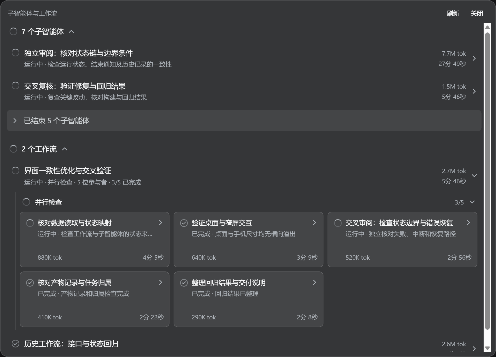
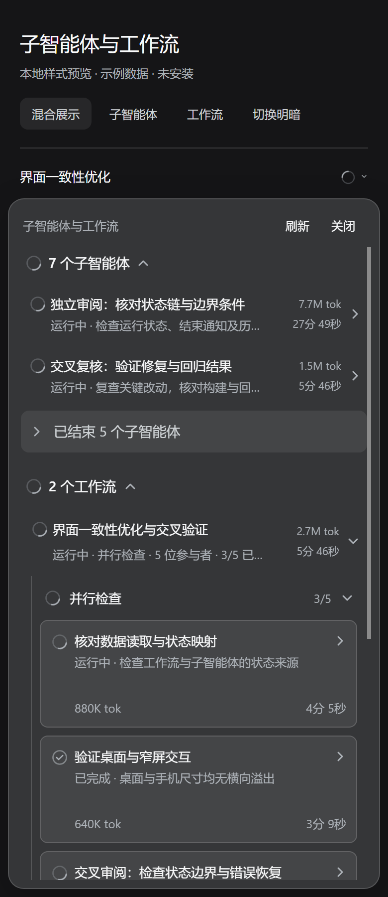

# ZCode 工作流与子智能体

在 DSH 选择 ZCode 后，可以直接要求它创建原生动态工作流。插件会在创建或恢复原生会话前协商工作流能力；不支持策略接口的旧 CLI 仍可进行普通对话。

有原生子智能体或工作流时，会话标题旁会出现进度入口。概览区分普通子智能体和工作流；活动工作流默认展开，结束后默认折叠，手动展开选择在轮询时保留。并行参与者按可用宽度排成三列、两列或单列。点击参与者可查看只读任务、结果、工具和思考时间线，并加载更早记录；Esc 或点击外部区域关闭概览。

父回合结束后，ZCode 自动产生的后续回复通过 DSH 原生收件箱进入正文和持久历史。载体只消费已有输出，不再发送模型提示词。后台任务沿用启动时权限；重复通知、已消费结果和用户主动取消的载体会被去重。重开已绑定的 DSH 会话时，可从 ZCode 库补齐已完成的工作流父会话回复；不重新执行历史工具或工作流。

## 兼容范围

- 数据形状以 ZCode 3.18.2 核对：普通子智能体来自 `session.task_type=subagent_child`；工作流来自 `dwf_run`、`dwf_actor`、`dwf_node`，参与者会话为 `workflow_child`。
- 数据库只在 Host worker 中只读打开。Client 只能提交 DSH 会话 ID 与分页游标，不能指定数据库路径或绕过父会话归属检查。
- 缺库或不兼容的表／列会显示不可用原因；未知状态保持未知，未记录用量不会显示为零。列表、正文和时间线均有读取上限，界面显示截断提示。
- 当前上下文占用来自主请求的原生观测，与累计计费 token 分开；子智能体用量不会覆盖父会话上下文。
- 此功能不提供外部历史导入或运行中 stop + resend 插话。

## 示例界面

截图使用仓库中的合成数据，来自实际注册的 React 组件；它们不代表一次真实工作流执行结果。





## 开发验证

使用 Node >=24.9，先按锁文件安装依赖并构建：

```sh
pnpm install --frozen-lockfile
pnpm run build
node --import ./tests/register-css-loader.mjs --test --test-concurrency=1 tests/zcode-background-turns.spec.ts tests/zcode-context.spec.ts tests/zcode-subagent.spec.ts tests/zcode-subagent-ui.spec.ts
```

设置 `QUICK_APPS_BROWSER_BIN` 指向本机 Chromium 后，可执行 `tests/zcode-native-menu-browser.spec.ts`，覆盖主题、折叠、详情、Esc／外部点击及 320/390/768/1280 宽度。该测试不安装浏览器。合成预览可单独生成：

```sh
node scripts/preview-zcode-subagents.mjs .agent-temp/zcode-preview
```

协议夹具、SQLite 读取、浏览器布局和真实 Host 执行是不同的验收层次。正式确认端到端集成，需要在隔离存储中完成创建工作流、显示参与者、父回合结束后的结果投递，以及重开后的持久历史检查。
