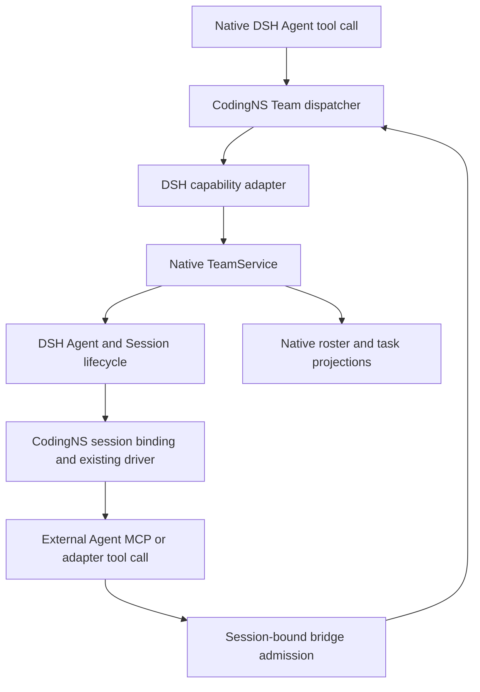

# Design: External Agent Team collaboration and management

Status: Accepted for implementation on 2026-10-17. This document describes the planned implementation; it does not report shipped behavior.

## 1. Decision and constraints

Cover requirements R1–R8 by extending the existing CLI feature and its bridge. DSH owns Team membership, task revisions, authorization, session logs, continuation ownership, and native projections. CodingNS owns adapter bindings, external process execution, tool transport, and provider-session recovery.

Full Team support starts at DSH alpha.2, with explicit routes bounded to alpha.3. The plugin manifest retains its current rc.2–alpha.3 range. There is no new standalone Team store, generic scheduler, external fork implementation, or required Client dashboard.

The existing `cliAdapters` feature owns the extension. Add optional capability requirements with `degrade` fallback, so ordinary adapters still start when Team support is missing. A future independent module would require its own FeatureRegistry descriptor; it is unnecessary for this scope.

## 2. Architecture and ownership

| Data/resource | Owner | CodingNS responsibility |
| --- | --- | --- |
| Root/member identity, role, name, roster phase | DSH | Resolve the exact live Agent; expose detached views |
| Tasks, ownership, dependencies, revisions | DSH | Validate DTO shape and forward native commands |
| Accepted peer input and sender attribution | DSH inbox/session | Forward new input to the selected driver without replacing provenance |
| Adapter/model/effort and provider session binding | Existing CodingNS registry/store | Apply child-specific selection, resume, and diagnose mismatches |
| Tool credential and pending bridge call | CodingNS bridge lifetime | Bind to one session/runtime generation; revoke and settle on disposal |
| External process, protocol, interactions | Existing driver | Execute, steer where supported, cancel, and release |

Business modules consume stable CodingNS interfaces. Put the new DSH structural adapter in `src/dsh-capabilities/host/agent-team-adapter.ts`, with routes and diagnostics in the existing capability registry. Preserve the current `native-team-proxy.ts` export/consumer contract during integration; use forwarding or a compatibility re-export if its implementation moves. Do not import version-specific DSH runtime types into drivers.

## 3. Capabilities and version behavior

Proposed stable IDs are `agent-team.external-member` and `agent-team.external-lead`. They describe Host contract availability, not blanket certification of every external adapter. Runtime diagnostics additionally report current membership, bridge enablement, provider registration, and per-adapter role eligibility.

| Host | New external Team integration | Existing behavior |
| --- | --- | --- |
| `0.2.0-rc.2`, `0.2.1-alpha.1` | Unavailable: minimum-version diagnostic | Ordinary sessions, delegation, native DSH Team remain unchanged |
| `0.2.1-alpha.2` | Available only after capability and adapter gates | Use host-native activation and direct inbox semantics |
| `0.2.1-alpha.3` | Same Team domain route; retain alpha.3 boundary adapters | Preserve live-peer admission and native session identity |
| Earlier fixtures or later unverified hosts | No supported route for the new feature | Respect the existing plugin compatibility policy |

Probe all operations required for the role, not just `listMembers` and `spawnTeammate`. The member interface needs membership, roster, messaging, task operations, and waits. The Lead interface additionally needs spawning and interruption. Missing methods produce role-specific diagnostics.

Observe optional `agentTeams` service installation/disposal using its Context lifetime. Build a fresh capability resolution for that service scope; do not mutate a frozen profile or make service availability at CodingNS startup a permanent verdict. Existing bridge disablement remains effective. No path automatically enables the DSH Team profile.

Native TeamService performs `startActivation()` on supported hosts. Retain `startNativeSubagent()` for ordinary delegation; do not create a Team member through the ordinary dispatch path and later attach it to a roster.

Alpha.3's `agentPreset` declaration and its peer/session activation rules remain confined to existing version adapters. Full Team support does not require alpha.3-only prompt translation or performance capabilities.

## 4. Tool and bridge contract

### 4.1 One plugin Team tool

Propose a Host tool named `agent_team`, exposed under each external transport's actual CodingNS namespace. Its actions are `status`, `members`, `spawn`, `message`, `tasks`, `task`, `task_create`, `task_update`, `wait`, and `interrupt`. The names and schemas are implementation contracts, not permission grants.

| Action | Input | Native operation |
| --- | --- | --- |
| `status`, `members` | No caller identity fields | `membership`, `listMembers` |
| `spawn` | Name, description, prompt, adapter, optional model/effort | `spawnTeammate` with a registered provider |
| `message` | Member target and text/content | `sendMessage` |
| `tasks`, `task` | Optional task ID as applicable | `listTasks`, `getTask` |
| `task_create` | Subject, description, blockers, write scopes | `createTask` |
| `task_update` | Task ID, expected revision, native action and allowed fields | `updateTask` |
| `wait` | Bounded timeout | `waitForChange` |
| `interrupt` | Teammate target | `interrupt` |

The native Host tool receives its caller from `exec.agent`. External calls use an authenticated `POST /v1/team` action endpoint on the existing loopback bridge listener. Keep the existing `/v1/dispatch` contract for ordinary subagents. The new endpoint accepts a fixed action union and bounded payload, never arbitrary method names, shell text, caller session IDs, or caller roles.

Use a per-session launch credential mapped by the Host to the session and runtime generation. Do not authorize Team calls with the existing server-wide token plus a caller-supplied `sessionId`. Resolve native membership again on every call; a stored Lead claim cannot survive a role/context change. Browser RPC retains the existing live-peer admission boundary and cannot supply bridge authority.

### 4.2 Tool discovery and guidance

Native Agents retain official Team tools. The plugin tool supplies explicit external adapter/model selection and follows native authorization. External Team sessions receive one canonical Team tool and current role/name guidance, rather than simultaneously receiving contradictory parent-only subagent instructions.

Keep native policy requiring the user's explicit request before creating teammates. An installed Team profile and available tool do not authorize automatic delegation.

Ordinary sessions keep their existing subagent tool and no-nesting policy. Team teammates may address siblings through TeamService; this does not relax ordinary parent/child messaging or allow nested delegation. Unavailable native services or adapter transports produce diagnostics, not a fallback to a provider's private Team implementation.

Use existing Codex/Claude/Command Code/ACP/OpenCode injection mechanisms where supported. Evaluate every currently registered external subagent provider individually. A provider's presence in `EXTERNAL_SUBAGENT_IDS` or a generic MCP injection helper is insufficient evidence of full Team support. No new provider IDs or application-control paths are added by this Spec.

## 5. Teammate creation and backend routing

1. Resolve the trusted live caller and verify native Lead membership, version eligibility, bridge enablement, and target-adapter eligibility.
2. Validate the requested model/effort against the adapter's capabilities/catalog. Reuse the selection queue to reserve one creation per parent/provider when conveying options to `prepareContinuable`.
3. Call `TeamService.spawnTeammate()` with the registered CodingNS provider and a fresh-history request. DSH allocates identity and writes provisioning/active/failed roster records.
4. The provider persists the external adapter and selected options against the DSH-reserved child session before first execution. Do not mutate global adapter preferences to convey a child's choices.
5. Return the native member identity and roster phase. The child may execute concurrently after the creation guard is released. A failed provisioning record stays under DSH ownership.

The `dsh` target must retain native execution even when the root uses an external route. Verify inherited Agent options and existing binding/history inference explicitly; changing a model name alone is insufficient proof of backend selection. Unsupported native per-child overrides return a diagnostic rather than changing another member's route.

## 6. Peer input, task operations, and waiting

### 6.1 Forward accepted input

Current `extractTurnInput()` selects human messages and selected internal notices. It skips `agent-message` relays, so a Team message can remain in history while `input.prompt` repeats the old user task.

Introduce a focused input-selection function that distinguishes human input, peer relay input, and internal continuation notices using native provenance and stable message identities. Forward all newly accepted peer input in inbox order. Preserve the original source in DSH history; a transport-specific prompt envelope carries the sender name without reclassifying it as a human instruction.

Track the dispatch position for the current provider session/turn using existing driver acceptance boundaries. A notice that resumes a retained iterator must not resend prior peer input. A new peer message arriving during suspension must not be consumed as a notice. Drivers with real steer use it; other drivers accept the message at the next supported DSH/provider boundary without starting a second concurrent provider turn.

Recovery uses the native session and existing provider binding. If acceptance cannot be established after a crash, report an uncertain delivery instead of automatically reissuing work. Do not introduce an exactly-once guarantee, a second conversation journal, or a retrying Team mailbox.

Historical `team-message` input remains readable and retains attribution. The new feature does not issue legacy mailbox sends on rc.2/alpha.1. Historical queued records remain historical after upgrading; the bridge does not replay, acknowledge, or rewrite them.

### 6.2 Native tasks and message results

Forward `expectedRevision`, ownership, blockers, and native task actions without maintaining local task transitions. Preserve native errors. Task readiness is advisory scheduling information; `inactive`, `turn/end`, and message acceptance are not task completion.

On alpha.2/alpha.3, `sendMessage()` returns inbox acceptance with a `messageId`; it does not return the old mailbox `status`. Expose this fact without promising synchronous persistence flush, recipient processing, retries, or deduplication of explicit resends.

### 6.3 Wait and interruption

Use native activity waits with bounded timeouts, cancellation, and re-query after wake-up. Match native tool policy by avoiding a wait when no peer can make progress; do not treat an inactive required teammate as completed. A cancelled wait does not cancel peer work. Lead interruption uses TeamService and reaches only the intended external execution; tasks retain native ownership until explicitly changed.

## 7. Lifecycle, diagnostics, and presentation

Runtime scope owns tool registrations, launch credentials, pending requests, waiters, and listeners. Native DSH owns member activation/drain. Existing drivers own process resources; cleanup must not kill unrelated runtime/application processes. Optional service removal revokes Team access and settles waits without disabling ordinary CLI sessions.

Resume existing native sessions before creation and reject identity changes. Preserve provider-session bindings and validate their usability; do not silently replace a teammate with a fresh provider conversation. Effective DSH permissions remain the source of external runtime restrictions.

Proposed diagnostic categories are unsupported version, missing Team service/operation, bridge disabled, adapter/role unsupported, caller unavailable, authorization rejected, provider session unavailable, identity mismatch, and uncertain delivery. Reuse native task errors rather than translating them into success. Messages and logs contain bounded, redacted summaries.

Reuse the native roster/task panel and existing external conversation/tool rendering. Surface role/adapter support reasons in existing CLI controls and locale fragments. No custom authoritative roster, task editor, or Team dashboard is introduced.

## 8. Correctness and verification

The following invariants drive tests: one DSH identity per member; native authority for every operation; child selection isolation; peer input is not replaced by stale human input; acceptance/activity/completion remain distinct; scoped failure and cleanup do not affect siblings; missing Team support does not disable ordinary sessions.

| Requirements | Design | Verification |
| --- | --- | --- |
| R1, R2 | §2, §4 | Real-shape fake Agent identities, role checks, tool discovery, native roster creation |
| R3 | §5 | Concurrent same-adapter/different-model creation, mixed native/external routing, preference isolation |
| R4 | §6.1 | Relay regression, multiple inbox messages, segmented turns, idle wake-up, uncertain recovery |
| R5 | §6.2–6.3 | Native task CAS/errors, truthful status, bounded waits and interruption |
| R6 | §4.1, §7 | Session spoofing, stale credentials, policy inheritance, cleanup and identity preservation |
| R7 | §3, §6.1 | alpha.2/alpha.3 positive fixtures; rc.2/alpha.1 and historical negative fixtures; service lifetimes |
| R8 | §7–8 | Native projections, existing UI diagnostics, per-adapter matrix and recorded runtime evidence |

Run source-based targeted regressions, `pnpm run typecheck`, `pnpm run version:check`, `pnpm run capability:check`, `pnpm run i18n:check`, and `git diff --check` during implementation. Regenerate capability reports with their script; never edit generated reports manually. `pnpm test` builds the project and is deferred until a build is explicitly authorized.

Live acceptance must cover both alpha.2 and alpha.3, Codex and Claude reference participants, and the three Lead/backend combinations using isolated authorized Stage0 resources. Record exact plugin/DSH/CLI versions, task revisions, native identities, peer delivery, cancellation, and recovery. Fake fixtures do not count as live certification. Historical fixtures include `0.1.5-rc.3`, `0.1.6-alpha.2`, and `0.1.7-rc.2` with explainable unsupported results.

## 9. Open verification items

- Confirm precise driver acceptance/steer boundaries before selecting the minimal input-dispatch state.
- Confirm explicit native child routing under an external Lead on both target versions.
- Inventory Team tool transport and recovery support for each existing external provider; leave unsupported roles unavailable with reasons.
- Validate optional Team service lifetime changes and runtime credential revocation with actual Cordis composition.
- Live runtime evidence and any application/build/server permissions remain separate from this documentation step.
