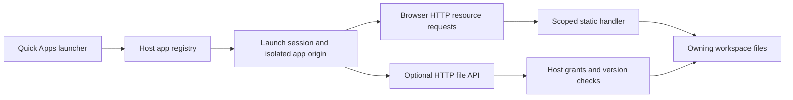

# Design — Quick Apps and controlled static HTTP hosting

Status: Draft, 2026-10-15. No Quick Apps HTTP implementation is claimed.

## 1. Overview

### 1.1 Goals and covered requirements

Serve a selected workspace directory as a small website, open it from a persistent shortcut, and offer a separate optional file API. This covers R1–R6. Ordinary static applications do not depend on `CodingNSWorkspace`, `showDirectoryPicker()`, or a preview-message protocol.

### 1.2 Constraints and existing evidence

- Host: Node and existing DSH authentication/connection services. Client: existing plugin framework, feature registry, settings bridge, localization, and DSH slots.
- DSH 0.2.1-alpha.3 exposes `sidebar.footer.action`, document-renderer registrations, and `webServer.register({ kind, path, handler })`. The WebServer service supplies routing, not a ready-made workspace static server.
- The existing native HTML packer is a Blob-based preview with limited direct JS/CSS packaging. It is not the required HTTP app runtime.
- `src/client/native-workspace-store.ts` provides workspace identities, including PeerHost records. `src/host/index.ts` resolves workspace roots. New operations must fail if that exact workspace cannot be resolved, with no fallback to another session/root.
- `src/client/settings-bridge.ts` supports Host-backed settings for remote clients. Shortcut metadata can use that boundary; temporary launch secrets must not be put in globally mirrored settings.
- This Spec does not authorize builds, running servers, installation, restart, publishing, or Desktop profile edits. Verification tasks identify when a real endpoint is required.

## 2. Architecture

### 2.1 Data flow

Text shortcuts use the document view and the same authoritative workspace identity. No synthetic conversation is created to satisfy a session-only file reader.

### 2.2 Responsibilities

| Component | Responsibility | Inputs / outputs |
| --- | --- | --- |
| Quick Apps client feature | Footer entry, app list, add/edit/remove, open/close, permission UI | Shortcut metadata and launch result |
| Quick Apps Host feature | Register management RPC, app routes, sessions and cleanup | Authenticated controlling client; no app-selected Host identity |
| Origin/routing adapter | Allocate a reachable app origin and route to the owning Host | Connection context + app identity → origin/route or diagnostic |
| App registry | Persist shortcuts with revision checks | Metadata only; no copied HTML or launch secrets |
| Launch/grant store | Bind app, principal, Host, workspace, permissions, revision and expiry | Host-owned temporary authorization |
| Static handler | Resolve and stream approved resources | GET/HEAD → bytes and HTTP metadata |
| File API | Bounded text reads, lists, creates, updates and deletes | Launch authorization + path + operation + version |

### 2.3 Launch, access and disposal

1. A trusted DSH client selects a persisted shortcut. The Host resolves its exact Host/workspace and checks the entry/root.
2. The origin adapter establishes a reachable isolated origin. Unavailable routing returns a diagnostic before the app runs.
3. The Host creates a temporary launch session using approved app grants. Credential delivery uses only an app-scoped channel; the page never receives the general DSH token.
4. The browser loads real resource URLs. Each server access checks the launch and current app revision before serving or mutating.
5. Close performs best-effort revocation; expiry handles abrupt client loss. Navigation/app replacement revokes the old embedding controller and write channel. Explicit revoke and module disposal deny further server requests.
6. Already downloaded bytes cannot be recalled. Cache policy and tests distinguish server revocation from removal of content already in browser memory.

## 3. Components and interfaces

### 3.1 Origin and routing contract — mandatory feasibility task

The desired URL shape is `https://<app-specific-origin>/<resource-path>`. The app root maps to `/`, preserving both relative and root-relative references. A shared `/apps/<id>/` URL path is not an origin boundary.

`AppOriginProvider.open(app, connection)` returns `{ origin, mount, dispose }` or a typed unavailable reason. One managed service may dispatch many app hostnames; a managed dedicated listener is an alternative only where the selected connection can actually reach it. No arbitrary per-app development server is started.

T1 must select and document a feasible delivery composition for Desktop remote access, direct Web, and PeerHost. It must verify hostname/port routing, TLS, proxy forwarding, embedded credential behavior, and app-to-DSH isolation. A WebServer prefix handler alone does not solve these questions. The implementation must not silently substitute the privileged DSH origin or a phone-local `127.0.0.1` address.

For embedded apps, `allow-same-origin` is acceptable only when the real app origin is isolated from DSH and other apps. Forms/downloads are enabled only as needed. App-response CSP and external-network policy are distinct from file grants. Do not claim the iframe sandbox by itself blocks all network access or execution stalls.

### 3.2 Data structures

| Model | Fields | Ownership / constraints |
| --- | --- | --- |
| `QuickApp` | `id`, `title`, `hostId`, `workspaceId`, `entryPath`, `documentRoot`, `kind`, `spaFallback`, `mounts`, `revision`, `order` | Persisted on controlling Host/profile; workspace-relative paths; `kind` is `html` or `text` |
| `AppMount` | `urlPrefix`, `workspacePath`, `read` | Same owning workspace; disjoint normalized URL prefixes; no arbitrary URL proxy |
| `AppGrant` | `appId`, `appRevision`, read roots, write roots, delete roots, approval metadata | Host authority; static read does not imply write/delete; code/root/permission changes invalidate remembered trust |
| `AppLaunch` | random ID/credential digest, app ID/revision, principal/connection identity, owning Host/workspace, granted operations, expiry, revoked state | Host-only ephemeral state; credentials never mirrored to other clients |

Source paths are resolved only by the owning Host. Display paths may be shown in trusted UI but never act as proof of authorization. Static serving excludes `.git` and secret files by policy; explicitly needed hidden data should use a narrowly approved mount or the file API.

### 3.3 Management and app interfaces

Proposed management RPC namespace: `quickApps/list`, `upsert`, `remove`, `launch`, `close`, `grant`, `revoke`. These are called by the authenticated DSH client, not directly exposed to app pages. Updates use the app registry revision; removing a shortcut does not remove files.

On the isolated app origin:

- `GET|HEAD /<resource-path>`: static bytes from the document root or approved mount.
- `GET /__quickapp/files?path=...`: bounded text read returning content and a version token.
- `GET /__quickapp/list?path=...`: explicit permitted directory listing; static directory browsing stays disabled.
- `PUT /__quickapp/files?path=...`: create/update text. Existing-file writes require `If-Match`; create-only uses `If-None-Match: *`.
- `DELETE /__quickapp/files?path=...`: requires delete permission and matching version.

`/__quickapp/` is reserved and rejected as an app mount. API routes are never SPA fallbacks. Mutations require app-scoped authentication and CSRF protections appropriate to the credential delivery selected in T1. CORS is narrow and does not allow the app to call privileged DSH APIs. A future `CodingNSWorkspace` compatibility wrapper may translate its calls to these interfaces; static hosting does not inject it by default.

### 3.4 HTTP resource behavior

Decode and normalize paths once at the routing boundary, then apply workspace and canonical-path checks. Reject ambiguous encoded separators and traversal rather than applying inconsistent double decoding. Binary resources stream as bytes; `.js`/`.mjs`, CSS, JSON, fonts and images receive correct MIME types and `nosniff`.

Preserve URL queries. Redirect directory requests to a trailing slash before serving `index.html`. Return actual 404/405 errors. Optional SPA fallback applies only to configured navigation requests accepting HTML; missing assets and API requests never return the entry HTML. Conditional caching must authenticate before 304 responses; use revalidation rather than long-lived private-data caches. Range requests may be added when required by supported resource fixtures; do not claim media/PDF streaming coverage before testing it.

## 4. Data and state model

### 4.1 Relationships and persistence

`Host/workspace → QuickApp → AppGrant → AppLaunch`. Registry updates preserve unrelated settings fields. There is no copy of the application's source or business data in the shortcut store. Files remain the data source.

### 4.2 State transitions

Shortcut availability is `available`, `missing-file`, `missing-workspace`, `disconnected-host`, or `unsupported-runtime`. Launch state is `active`, `expired`, `revoked`, or `invalidated`. Revoked/expired launches cannot return to active; opening again creates a new launch. No background polling is needed for expiry checks.

### 4.3 File consistency

Retain atomic replacement, create-only semantics, size limits, and per-path serialization from the earlier helper where suitable. Recheck grants and canonical paths when a queued mutation executes, not only before entering its queue. Use a content-version token for read/write/delete preconditions. The plugin serializes its own operations; external tools can still race filesystem operations, so do not promise a cross-process transaction or an OS-level security sandbox.

## 5. Error handling

Use existing RPC error envelopes for management calls and HTTP JSON errors for the file API. Codes include `QUICK_APP_UNAVAILABLE`, `QUICK_APP_ORIGIN_UNAVAILABLE`, `QUICK_APP_ACCESS_DENIED`, `QUICK_APP_LAUNCH_EXPIRED`, `QUICK_APP_REVOKED`, `QUICK_APP_CONFLICT`, and `QUICK_APP_TOO_LARGE`.

Unauthenticated requests return 401; denied operations 403; missing resources 404; wrong methods 405; revoked/expired launches 410; stale version preconditions 412; oversized writes 413; unavailable Host/routing 503. Failures never fall back to another Host/root or turn a failed save into a success. Logs include app ID, operation and result, excluding credentials and file contents.

## 6. Correctness properties

1. **Static compatibility (R2):** allowed resource URLs keep ordinary HTTP semantics; no SDK or page-specific message protocol is necessary.
2. **Authoritative scope (R3/R5):** resource parameters cannot change the launch's Host, workspace, grants or revision.
3. **Optional mutation (R4):** read-only launches cannot write/delete; creation cannot overwrite; stale updates/deletes fail.
4. **Independent identity (R1/R6):** shortcut lifetime is independent of conversation selection or deletion.
5. **Cleanup (R3/R6):** disabling/revoking prevents new work and releases owned routes/listeners without disturbing other modules.

## 7. Verification strategy

Unit tests cover registry revisions, normalization, grant decisions, expiry/revocation, MIME resolution and SPA classification. Source integration tests cover workspace and PeerHost routing, file preconditions, module disposal, and capability availability.

A browser fixture must use unchanged HTML with relative/root-relative scripts, ES modules and dynamic imports, CSS imports, images/fonts, JSON fetches, Unicode paths and navigation reloads. Test a second app and the DSH UI as separate origins. Mutation tests verify exact target files, no browser-download substitution, stale writes/deletes, and rejected app-supplied identities.

| Requirement | Design | Required evidence |
| --- | --- | --- |
| R1 | §§2.3, 3.2, 4 | Persistence, missing source, no active conversation, shortcut removal |
| R2 | §§3.1, 3.4 | Real HTTP resource/browser fixture; actual 404 and SPA boundary |
| R3 | §§3.1–3.3, 4.2 | Cross-origin/app/workspace denial, traversal, revocation, credential checks |
| R4 | §§3.3, 4.3 | Read-only denial, create/update/delete preconditions, atomic save |
| R5 | §§2.3, 3.1 | Reachable mobile HTTPS and correct PeerHost; explicit unsupported state |
| R6 | §§1.2, 2.2 | Slot/module lifecycle, localized UI, capability fixtures and migration |

Tests that require a listening server or a live Desktop must be run only within the authorization applying at that time. Source-only tests do not prove live mobile operation.

## 8. Migration, risks and remaining decisions

The seven files attributed to this session are reviewed in `specs/spec016-快捷应用与受控静态HTTP托管/docs/20261015-未提交改动归属与方案符合性评审.md`. They implement a native-preview connector, not this HTTP runtime. Preserve them during planning; later extract tested filesystem helpers and replace session-only routing with workspace/app routing. Do not broadly reset or delete other changes.

The largest unresolved implementation item is app-origin provisioning through real Desktop remote/HTTPS/PeerHost paths. T1 must produce concrete transport evidence before declaring that design complete. Credential delivery inside cross-site frames also requires browser verification. Existing backend-dependent apps and service workers are outside this first implementation; ordinary static apps remain the target.

The earlier DOM bridge lacks a DSH capability boundary and Host-owned launch grants. It must not become the new app runtime through a rename alone. Its `ifMtime` tests remain useful but do not cover HTTP, browser origin isolation, or unconditional delete conflicts. The existing member HTML adapter remains outside this repository and must be migrated deliberately when a compatible replacement exists.
